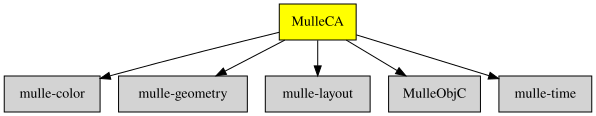

# 🍃 MulleCA

#### 🍃 Animate objects in realtime

Animation in simple programs is often tied to the framerate. With CAAnimation
you get a little framework to tie animation to real time, which can make things
look smoother for the viewer. MulleCA offers quantized animation, which
ensures that animation values do not fall between the cracks of the frameRate,
which can lead to accumulation errors and other imprecisions.

This library is independent of any drawing library.

### You are here

