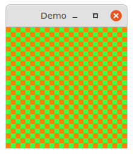
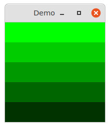
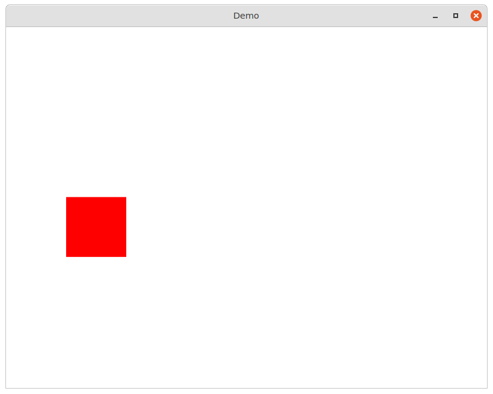
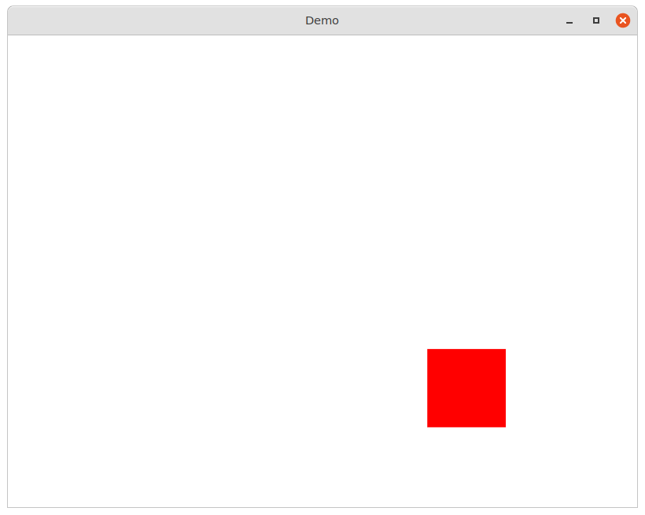
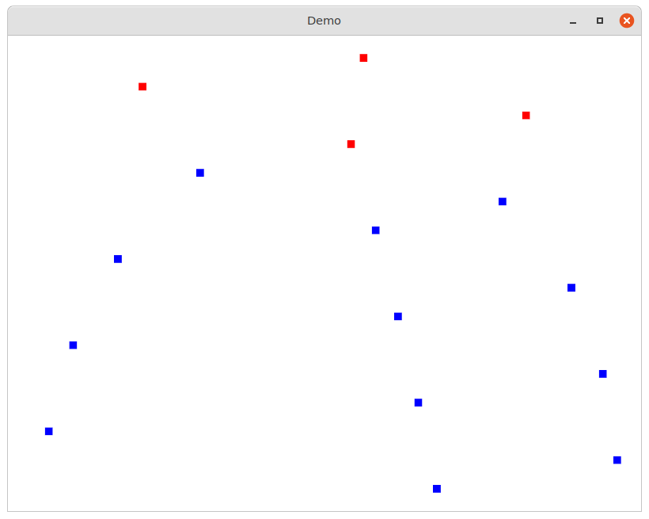
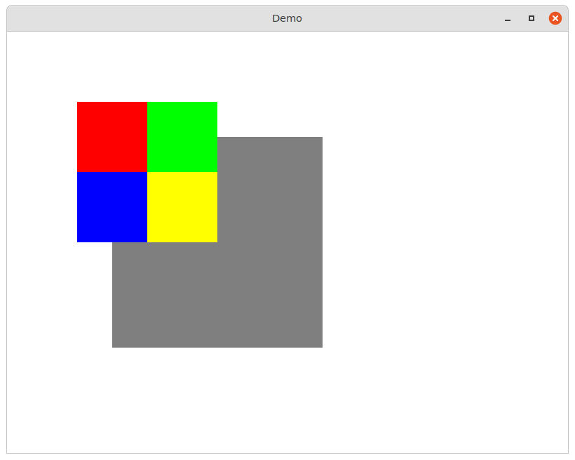

# demos

#### 💥 demos of MulleCA

Run conveniently with [mulle-project-run-demos](//github.com/mulle-nat/mulle-project),
after building with `mulle-sde craft`.

## CALayer

## canvas

This demo shows how to setup a window quickly and attach some drawing code
to a CALayer without having to subclass.



[source](src/main-canvas.m)


## draw-simple

Changing the drawing code of a CALayer on the fly can be used for a simple
kind of animation.



[source](src/main-draw-simple.m)


## CAAnimation

### animate-non-additive

Two animations are placed on a layer. One animates in the X direction and
reverses. The other animates in the Y direction and reverses after a short
delay. Because the animations are declared as non-additive, the second
animation will effectively "clobber" the first one.



[source](src/main-animate-additive.m)

## animate-additive

Two animations are placed on a layer. One animates in the X direction and
reverses. The other animates in the Y direction and reverses. Because they
are declared as additive, both "forces" merge and the layer is animating
in an ellipse pattern.



[source](src/main-animate-additive.m)


## tween

Demo of the builtin tween functions.



[source](src/main-tween.m)


## uiview

A coarse animation that places the view pixel perfect into its destination.
There is no final "snap".



[source](src/main-uiview.m)


## Build

This is a [mulle-sde](https://mulle-sde.github.io/) project.

It comes with its own virtual environment and list of dependencies.
To fetch and build everything say:

```
mulle-sde craft
```
